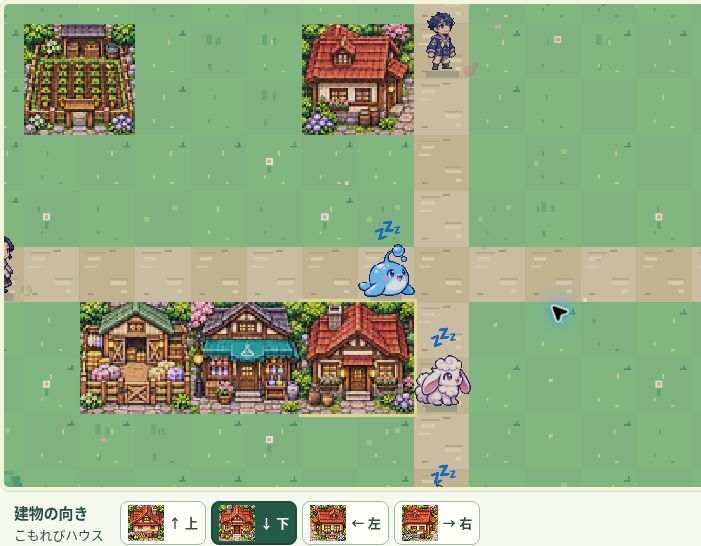

# Ver.1.13.26　建物の敷地と4方向のドット絵

- 全26種類の施設に、上下左右を向いたドット絵を1枚ずつ用意しました。道と接する敷地の端まで、建物ごとの石畳や植栽、柵が続きます。
- 建設中や移設中は、地図の下の「建物の向き」で絵を選んでから配置できます。設置済みの施設は、地図でタップするとその場で向きを変更できます。
- 既存の牧場は下向きで引き継ぎます。向きは施設ごとに保存され、世界樹は成長段階ごとに4方向の絵に切り替わります。

