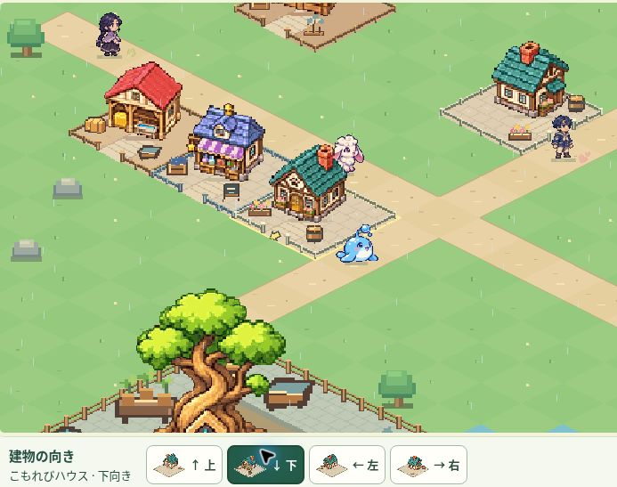

# Ver.1.13.27　クォータービューの牧場

牧場を横45°・俯角30°相当のクォータービューに変更しました。地面の1マスは64×32pxのひし形です。建物の土台、道の縁、柵の横木は、横2ドットに対して縦1ドットの傾きでつながります。

全26施設の建物と敷地を描き直しました。素材牧場には木柵と飼い葉桶、旅人の宿には玄関灯と荷物、とっくん広場にはロープ柵と武具立てがあります。世界樹は成長に合わせて苗の育成棚や石の囲いも変わります。

建設中・移設中は、地図の下にある「建物の向き」で上下左右を選べます。建てたあとも地図上の施設をタップして変更できます。施設欄の「↻ 向きを変える」を押すと90度ずつ回転します。選択中は黄色い矢印が門の位置を示します。

地図を拡大・移動しても、建設、移設、道・池の配置はタップしたひし形のマスに対応します。屋根をタップして建物を選ぶこともできます。

向きは施設ごとに保存されます。Ver.1.13.26の牧場は設定済みの向きで、それ以前の牧場は下向きで開きます。

[全施設の4方向を画像で見る](building-catalog.png) · [ゲーム本体と建物ドット絵112枚をダウンロード](monster-biyori-1.13.27.zip)

