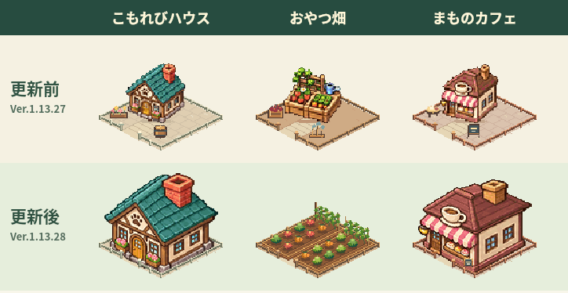

# Ver.1.13.28　道に面した家と畑

- こもれびハウスとまものカフェの屋根や壁を、2×2マスの敷地いっぱいに広げました。おやつ畑には、門から続く細い通路の両側に野菜のうねと豆の棚が並びます。
- 全26施設の4方向の絵を、同じ敷地の中心と奥行きに合わせました。たまごの泉は水盤の中心、世界樹は各成長段階の根元が敷地の中央に来ます。
- 建設・移設・回転には、黄色い矢印が示す正面の辺に道が1マス以上必要です。正面にある最後の道は「道けし」や池への変更、世界樹の移設から保護されます。
- 仲間と職員は施設の正面へ歩き、お店の先頭のお客さんは正面で会計します。「向きを変える」は正面に道がある次の向きに回ります。建設・移設のプレビューでは4方向すべてを選べます。

旧セーブを最初に開くと、横や裏だけに道がある施設は、今の場所で道の方を向きます。周囲に道がない施設も元の場所に残るので、正面に道を敷いて利用できます。

[ブラウザで遊ぶ](game.html) · [全施設の向き一覧](building-catalog.png) · [ゲームと建物ドット絵112枚をダウンロード](monster-biyori-1.13.28.zip)
