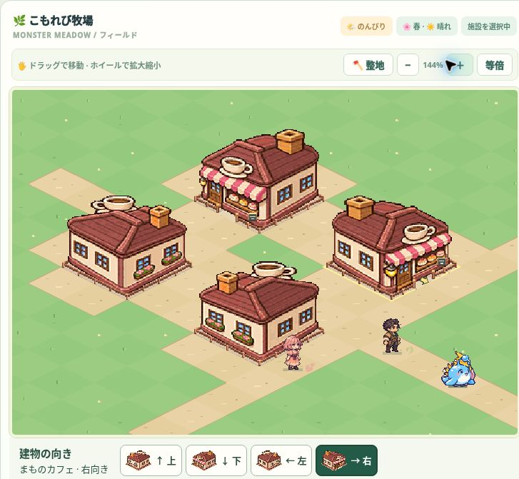

# Ver.1.24.2　建物の四方向ドット絵を更新

まものカフェを右向きにしても、屋根のコーヒーカップ、ピンクのひさし、扉とケーキの陳列窓がそろうようになりました。上向き・左向きでは、カップが屋根の向こうに見えます。

- こもれびハウスの肉球章、いやしの診療所の葉の看板、冒険者ギルドの交差した剣などを、入口と一緒に回るように描き直しました。
- おやつ屋台のりんごとお菓子、素材牧場の干し草と水おけは、正面が見えるどちらの向きでも同じ順番に並びます。ほしぞら展望台は、裏に回ってもドームの向こうに望遠鏡の先が見えます。
- 世界樹は3つの成長段階ごとに、根元の結晶と階段の位置をそろえました。

全26施設の4方向を点検し、うち22施設の96枚を更新しました。Ver.1.24.1の牧場は、建物の位置・向き・レベルごと引き継げます。建て直しは不要です。

[ブラウザで遊ぶ](game.html) · [全26施設の向き一覧](building-catalog.png) · [ゲームとドット絵をダウンロード](monster-biyori-1.24.2.zip)
